[[LV]](#latviesu) [[EN]](#english) [[Ekrānšāviņi / Screenshots]](#screenshots)  

<a id="latviesu"></a>

# Pārtikas piegādes pasūtīšanas sistēma

Šis ir mācību centra "BUTS" noslēguma projekts. Projekta galvenais mērķis ir parādīt savas profesionālās projektēšanas un programmēšanas prasmes, kas tika pilnveidotas, apgūstot mācību centra kursu. Projektā tika izmantotas gan mācību centrā, gan patstāvīgi iegūtās zināšanas.

## Funkcijas

- 🔐 **Lietotāju autentifikācija un reģistrācija** – iespēja reģistrēties un autentificēties, izmantojot e-pastu un paroli.
- 📦 **Produktu saraksta pārlūkošana** – pieejamo produktu saraksts ir redzams gan reģistrētiem lietotājiem, gan vietnes viesiem.
- 🌙 **Tēmas izvēle** – lietotājs var ērti pārslēgties starp gaišo un tumšo vizuālo tēmu.
- 🌐 **Daudzvalodu atbalsts** – sistēmas saskarne ir lokalizēta un pieejama latviešu un angļu valodā.
- 📱 **Adaptīvs dizains** – saskarne ir optimizēta un ērti lietojama gan datorā, gan planšetdatorā, gan mobilajā tālrunī.
- 🛒 **Iepirkumu grozs** – iespēja pievienot produktus grozam, mainīt to daudzumu, noņemt produktus un apskatīt kopējo cenu.
- 🧾 **Pasūtījuma noformēšana** – iespēja noformēt pasūtījumu, norādot nepieciešamo informāciju.
- 📋 **Pasūtījumu pārvaldība** – iespēja apskatīt un pārvaldīt pasūtījumus atbilstoši lietotāja lomai.
- 👤 **Profila datu rediģēšana** – lietotājs var apskatīt un mainīt sava profila datus.
- 🔑 **Paroles maiņa** – lietotājs var nomainīt sava konta paroli.
- 👨‍💼 **Lomu un piekļuves tiesību pārvaldība** – sistēma nodrošina atšķirīgas iespējas administratoriem, operatoriem, kurjeriem un klientiem.
- 📦 **Noliktavas atlikumu pārvaldība** – produktu atlikumi tiek atjaunināti atbilstoši pasūtījumiem un to izmaiņām.
- 🧑‍💼 **Pasūtījumu apstrāde operatora lomā** – operators var apskatīt viņam piešķirtos pasūtījumus, uzsākt to apstrādi un piešķirt kurjeru.
- 🚚 **Pasūtījumu piegādes pārvaldība** – kurjers var uzsākt viņam piešķirtā pasūtījuma piegādi un atzīmēt to kā piegādātu.
- 🧾 **PDF pasūtījuma čeka ģenerēšana** – sistēma nodrošina iespēju ģenerēt un lejupielādēt PDF dokumentu ar pasūtījuma informāciju.
- 📋 **Pasūtījumu administrēšana** – administrators var apskatīt visus pasūtījumus, mainīt to statusus, rediģēt pasūtījumu saturu, atcelt pasūtījumus un atjaunot atceltos pasūtījumus.
- 🛠️ **Produktu administrēšana** – administratoram ir iespēja pievienot, rediģēt un pārvaldīt produktus.
- 👥 **Lietotāju administrēšana** – administratoram ir iespēja apskatīt un pārvaldīt sistēmas lietotājus.

## Tehnoloģijas

- PHP
- Laravel
- React
- MySQL
- Eloquent ORM
- Blade
- HTML
- SCSS
- JavaScript
- Vite
- Git

## Prasības 

1. PHP 8.2+
2. Composer
3. Node.js 20+ un npm
4. MySQL
5. Git

## Installēšana

### 1. Projekta klonēšana

```bash
git clone https://github.com/DenissSablinskis/food-delivery-order-system.git
cd food-delivery-order-system
```
### 2. Backend atkarību instalēšana
```bash
composer install
```
### 3. .env faila izveide
```bash
cp .env.example .env
```

Windows PowerShell vidē:
```PowerShell
Copy-Item .env.example .env
```
### 4. Lietotnes atslēgas ģenerēšana
```bash
php artisan key:generate
```

**### 5. Publiskās krātuves saites izveide**

```bash
php artisan storage:link
```

### 6. Datubāzes konfigurēšana

Atjaunini šādas vērtības .env failā:
```.env
DB_CONNECTION
DB_HOST
DB_PORT
DB_DATABASE
DB_USERNAME
DB_PASSWORD
```

Izveido datubāzi pirms palaist migrācijas.
### 7. Migrāciju un seederu palaišana
```bash
php artisan migrate:fresh --seed
```
### 8. Frontend atkarību instalēšana
```bash
npm install
```
### 9. Frontend resursu izveide
```bash
npm run build
```

Ja PowerShell bloķē npm komandu, izmanto:
```PowerShell
npm.cmd run build
```
### 10. Lietotnes palaišana
```bash
php artisan serve
```
### 11. Atver lietotni pārlūkprogrammā
```
http://127.0.0.1:8000
```

## Datubāze

Sistēma sastāv no četriem Eloquent modeļiem.

- `Lietotājs`
- `Pasūtījums` 
- `Pasūtītais produkts`
- `Produkts`

Relācijas:

```text
 Lietotājs 1 ──── * Pasūtījums
 Pasūtījums 1 ──── * Pasūtītais produkts
 Pasūtītais produkts * ──── 1 Produkts
```

Šīs relācijas ir definētas Eloquent modeļos:

- `Lietotājs` hasMany `Pasūtījumi`
- `Pasūtījums` belongsTo `Lietotājs`

- `Pasūtījums` hasMany `Pasūtītie produkti`
- `Pasūtītais produkts` belongsTo `Pasūtījums`

- `Produkts` hasMany `Pasūtītie produkti`
- `Pasūtītais produkts` belongsTo `Produkts`

## Demonstrācijas konti

Lai pārbaudītu projekta darbību, var izmantot iepriekš izveidotus testa lietotājus:

#### Lietotājs
- **E-pasts:** sofija.berzina@gaisma.lv
- **Parole:** sofija1234

#### Administrators
- **E-pasts:** admin@gaisma.lv
- **Parole:** admin1234

#### Operators
- **E-pasts:** laura.ozola@gaisma.lv
- **Parole:** laura1234

#### Kurjers
- **E-pasts:** kristine.kalnina@gaisma.lv
- **Parole:** kristine1234

## Testēšana

Projektā ir 45 Laravel Feature testi, 8 React Ject testi.

Lai palaistu Laravel testus:

```bash
php artisan test
```

Lai palaistu React testus:
```bash
npm test
```

Pilnu testu sarakstu un to rezultātus skatiet sadaļā [Testēšanas rezultāti](tests.md).

<a id="english"></a>

# Food Delivery Ordering System

This project is the final project for the "BUTS" training center. The main purpose of the project is to show my professional design and programming skills, which were improved during my studies at the "BUTS" training center. In this project, I used knowledge that I got in the training center and learned by myself.

## Features

- 🔐 **User authentication and registration** – users can register and log in using an email address and password.
- 📦 **Product list browsing** – the list of available products is accessible to both registered users and guests.
- 🌙 **Theme selection** – users can easily switch between light and dark themes.
- 🌐 **Multilingual support** – the system interface is available in Latvian and English.
- 📱 **Responsive design** – the interface is optimized for use on computers, tablets, and mobile phones.
- 🛒 **Shopping cart** – users can add products to the cart, change quantities, remove products, and view the total price.
- 🧾 **Order placement** – users can place orders by providing the required information.
- 📋 **Order management** – orders can be viewed and managed according to the user's role.
- 👤 **Profile editing** – users can view and update their profile information.
- 🔑 **Password change** – users can change their account password.
- 👨‍💼 **Role and access control** – the system provides different permissions for administrators, operators, couriers, and customers.
- 📦 **Inventory management** – product stock quantities are updated according to orders and changes made to them.
- 🧑‍💼 **Order processing by operators** – operators can view their assigned orders, start processing them, and assign a courier.
- 🚚 **Delivery management** – couriers can start delivering their assigned orders and mark them as delivered.
- 🧾 **PDF receipt generation** – the system allows users to generate and download a PDF document containing order information.
- 📋 **Order administration** – administrators can view all orders, change their statuses, edit order contents, cancel orders, and restore cancelled orders.
- 🛠️ **Product administration** – administrators can add, edit, and manage products.
- 👥 **User administration** – administrators can view and manage system users.

## Technologies

- PHP
- Laravel
- React
- MySQL
- Eloquent ORM
- Blade
- HTML
- SCSS
- JavaScript
- Vite
- Git

## Requirements

1. PHP 8.2+
2. Composer
3. Node.js 20+ and npm
4. MySQL
5. Git

## Installation

### 1. Clone the repository

```bash 
git clone https://github.com/DenissSablinskis/food-delivery-order-system.git
cd food-delivery-order-system
```
### 2. Install PHP dependencies
```bash
composer install
```
### 3. Create the enviromental file
```bash
cp .env.example .env
```
Windows PowerShell:
```PowerShell
Copy-Item .env.example .env
```
### 4. Generate the application key
```bash
php artisan key:generate
```

### 5. Create the Public Storage Link

```bash
php artisan storage:link
```

### 6. Configure the database

Update the database settings in the `.env` file:

```.env
DB_CONNECTION
DB_HOST
DB_PORT
DB_DATABASE
DB_USERNAME
DB_PASSWORD
```

Create the database before running migrations.
### 7. Run migrations and seeders
```bash
php artisan migrate:fresh --seed
```
### 8. Install frontend dependencies
```bash
npm install
```
### 9. Build frontend assets
```bash
npm run build
```
If PowerShell blocks the npm command, use:
```PowerShell
npm.cmd run build
```
### 10. Run the application
```bash
php artisan serve
```
### 11. Open in browser
```
http://127.0.0.1:8000
```

## Database

The application contains four Eloquent models:

- `User`
- `Order` 
- `OrderedProduct`
- `Product`

Relationship: 
 
```text
 User 1 ──── * Order
 Order 1 ──── * Ordered product
 Ordered product * ──── 1 Product
```

These relationships are defined in the Eloquent models:

- `User` hasMany `Orders`
- `Order` belongsTo `User`

- `Order` hasMany `Ordered products`
- `Ordered product` belongsTo `Order`

- `Product` hasMany `Ordered products`
- `Ordered product` belongsTo `Product`

## Demo Accounts

The following test accounts can be used to explore the application's functionality.

### Customer
- **Email:** sofija.berzina@gaisma.lv
- **Password:** sofija1234

### Administrator
- **Email:** admin@gaisma.lv
- **Password:** admin1234

### Operator
- **Email:** laura.ozola@gaisma.lv
- **Password:** laura1234

### Courier
- **Email:** kristine.kalnina@gaisma.lv
- **Password:** kristine1234

## Testing

The project includes 45 Laravel Feature tests, 8 React Jest tests.

To run Laravel tests:

```bash
php artisan test
```

To run React tests:
```bash
npm test
```

See the [Testing Results](tests.md) for the full list of tests and their results.


<a id="screenshots"></a>

## Ekrānšāviņi / Screenshots

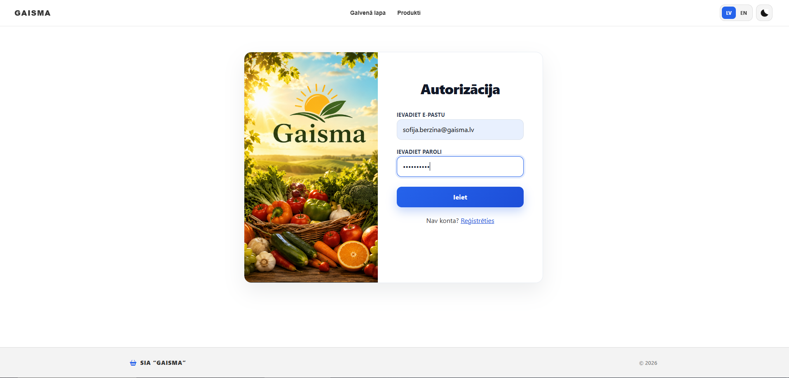
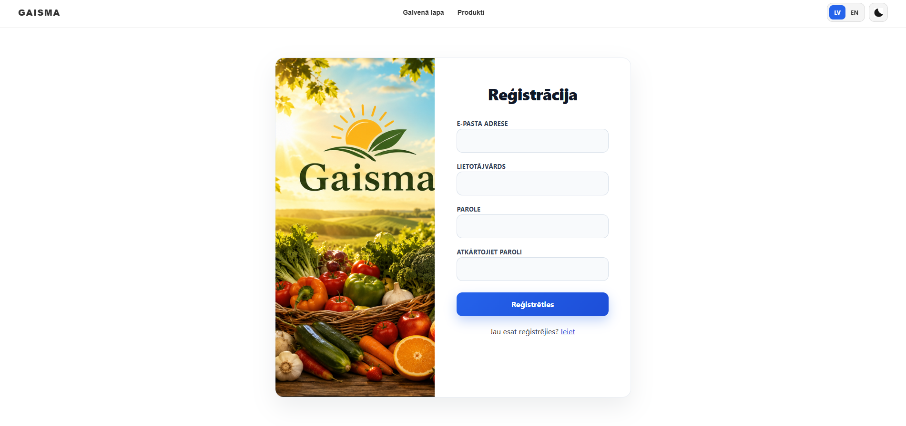
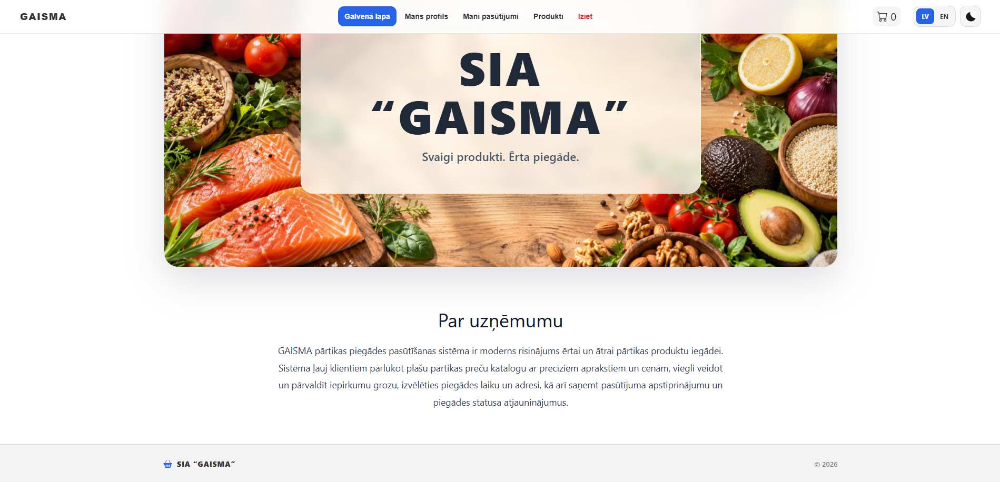
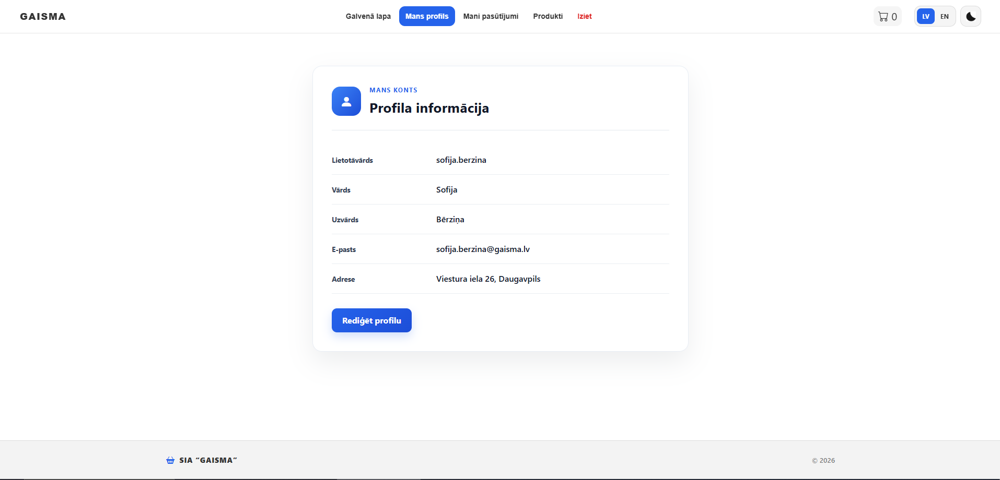
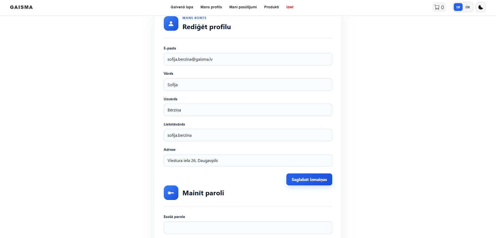
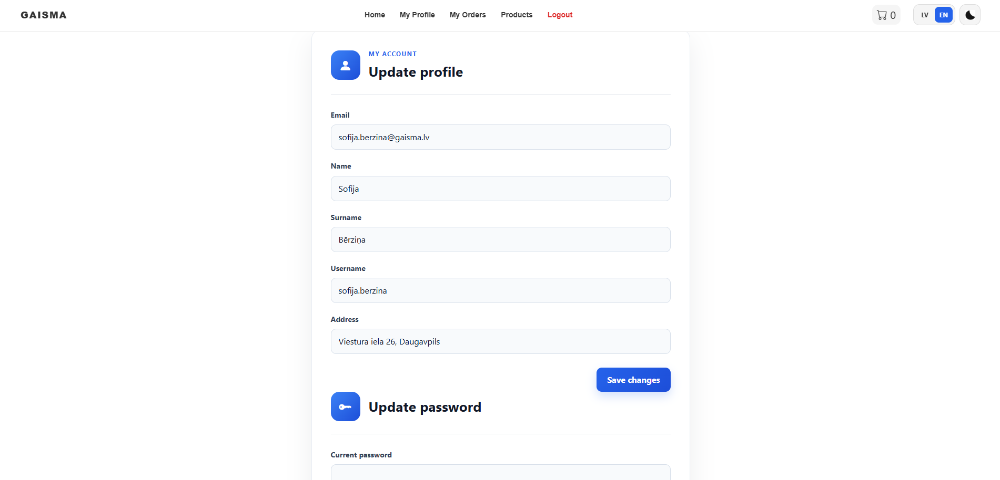
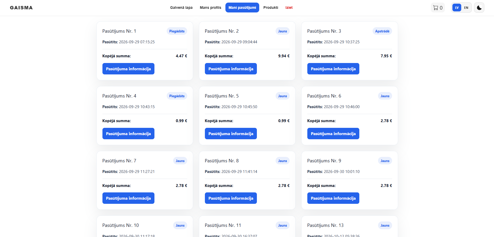
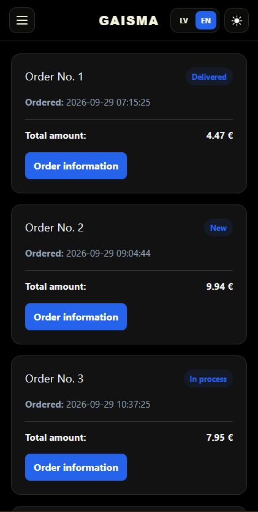
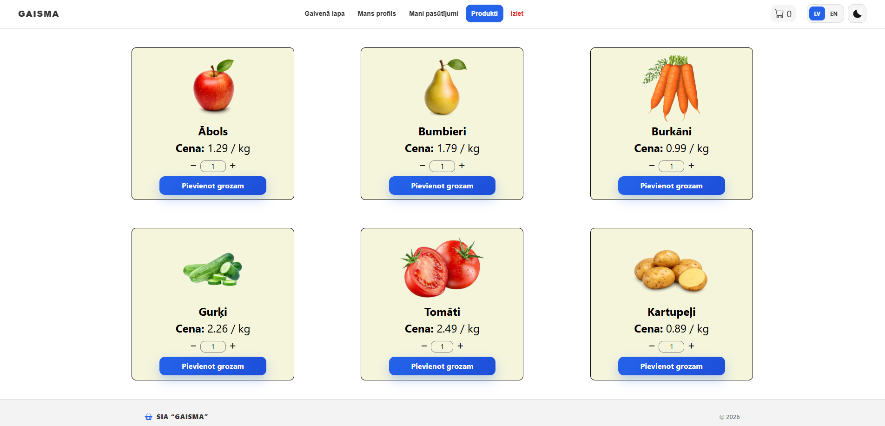
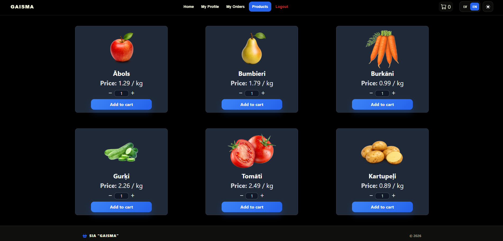
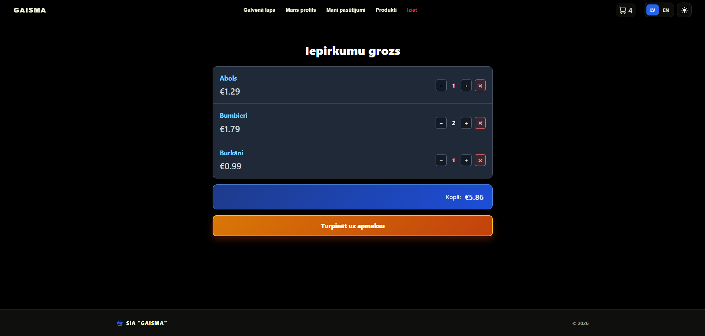
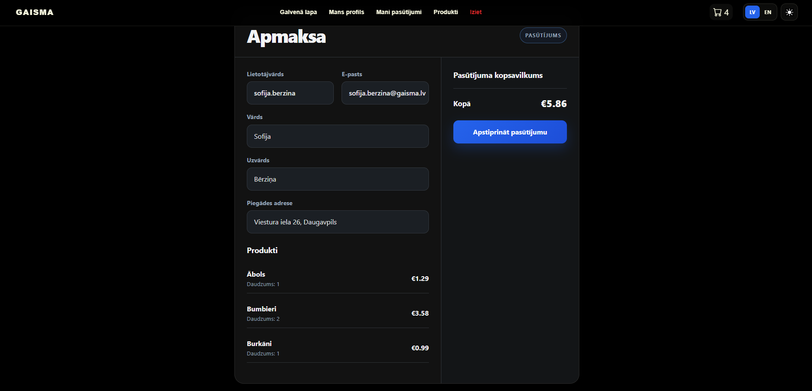
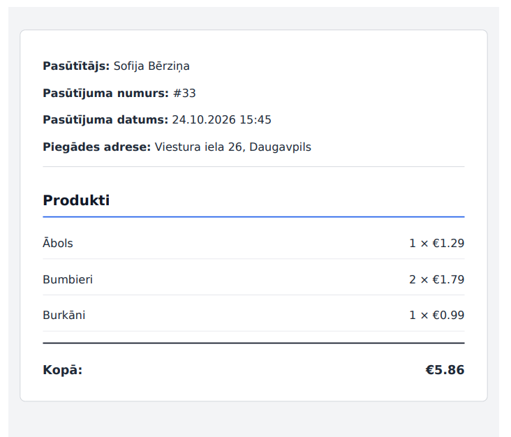
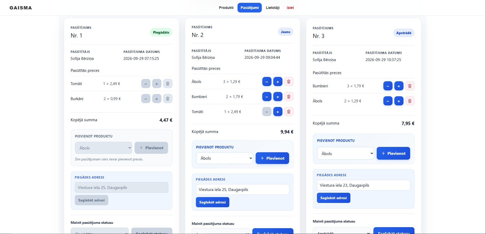
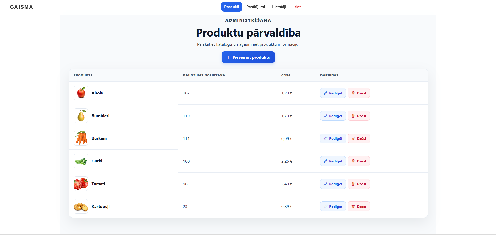
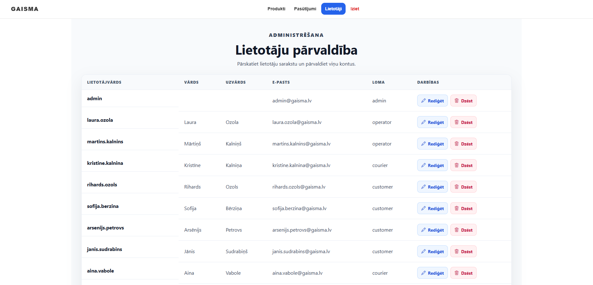
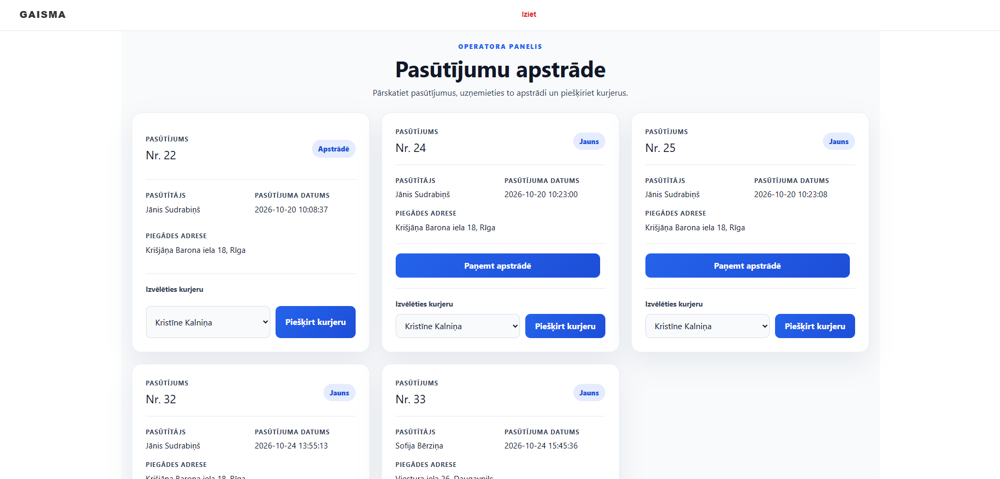
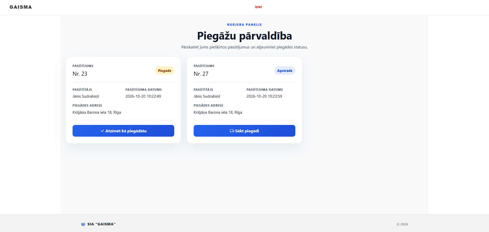

